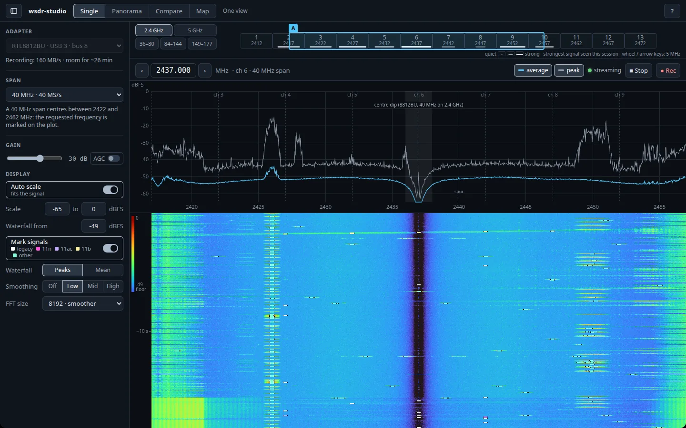
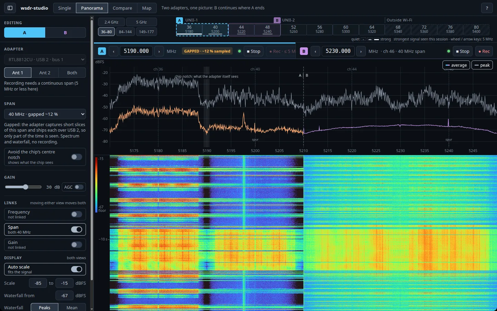
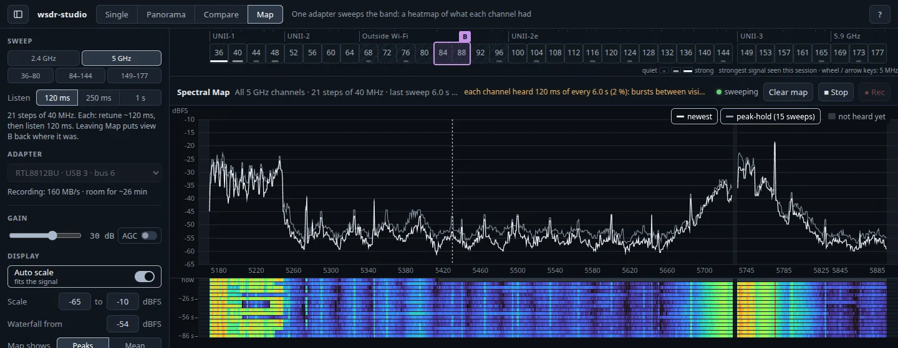

# wsdr-studio

A desktop app that turns a Realtek RTL8812BU (or RTL8812CU) USB Wi-Fi dongle into a live spectrum
receiver: plug it in, press Start, pick a Wi-Fi channel, watch the spectrum and waterfall. With two
dongles it shows two views side by side on one axis (Panorama) or stacked on the same channel
(Compare), and one dongle can sweep a whole band into a heatmap (Spectral Map).

- **How it works:** it uses the receive path from [wifi-sdr](https://github.com/snokvist/wifi-sdr),
  which streams the chip's baseband sample ring (LA mode) over USB with custom on-chip code, brought
  up by [devourer](https://github.com/OpenIPC/devourer). A C++ backend owns the dongle and computes
  the spectrum; the UI (React) runs in a bundled Electron window. No browser needs to be installed.
- **What you get:**
  - 8812BU on USB 3: spans of 2.5–40 MHz, and the full 40 MHz band at 40 MS/s. Also an 80 MHz span,
    gapped: one 8192-sample slice at 80 MS/s (~77 MHz at −6 dB), ~0.2 ms to ship it, ~33 % of the time
    sampled. The chip's 80 MHz filter has a ~±2.5 dB ripple across the band.
  - 8812BU on USB 2, or the 8812CU: 2.5 and 5 MHz continuous (the 8812BU is normally switched to USB 3
    at Start, see below).
  - 8812CU (and an 8812BU left at USB 2), gapped: 10, 20 and 40 MHz spans listed as "gapped" in the Span list. The dongle captures
    one 8192-sample slice, ships it over USB 2 (~1.5 ms), and repeats: 35 / 21 / 12 % of the time is
    sampled. Good for watching a band; short bursts can fall in the gaps, and recording needs a
    continuous span. Gapped spans are only used when picked.
  - The app shows what the adapter itself sees: the 8822C notches its tuned centre (~±0.6 MHz), the
    8812BU dips at its centre at 40 MHz on 2.4 GHz; both are shaded and labelled. On the 8812CU,
    "Avoid the chip's centre notch" (off by default) cuts the 10 and 20 MHz views from a 40 MHz
    capture tuned beside them, so the notch sits outside the channel.
  - Both adapters: two antennas (A, B, or both overlaid). The 8812BU's are coherent at 20 and 40 MHz
    spans; at its narrower spans the chip only drops samples, so there they are two separate views.
  - Fixed gain or the chip's AGC, and raw IQ recording (SigMF).
- **Receive only.** The app never transmits.
- **Platform:** Linux, x86-64, glibc ≥ 2.34 (Ubuntu 22.04 or newer and similar).

## Screenshots

**Single:** one 8812BU at 40 MHz on 2.4 GHz ch 6, Mark signals on. Wi-Fi frames are marked on the
waterfall, and the band ruler's bars show the strongest signal per channel.



**Panorama:** an 8812CU (A, gapped) and an 8812BU (B) side by side, 80 MHz across UNII-1. The
shaded slot at A's centre is the 8812CU's own notch.



**Spectral Map:** one 8812BU sweeps all of 5 GHz, ch 68–96 included, one row per sweep.



## Quick start

1. **Download** `wsdr-studio-x86_64.AppImage` from the
   [Releases](https://github.com/snokvist/wsdr-studio/releases) page and make it executable:
   ```sh
   chmod +x wsdr-studio-x86_64.AppImage
   ```
2. **Allow your user to open the dongles** (once, needs root), then unplug and replug the dongle:
   ```sh
   sudo tee /etc/udev/rules.d/99-wsdr.rules > /dev/null <<'RULES'
   SUBSYSTEM=="usb", ATTRS{idVendor}=="0bda", ATTRS{idProduct}=="b812", TAG+="uaccess", MODE="0660", GROUP="plugdev"
   SUBSYSTEM=="usb", ATTRS{idVendor}=="0bda", ATTRS{idProduct}=="c812", TAG+="uaccess", MODE="0660", GROUP="plugdev"
   RULES
   sudo udevadm control --reload
   ```
3. **Optional: keep the kernel's Wi-Fi driver off the dongles.** Start takes a dongle over from the
   kernel driver anyway, but the driver grabs it again at every plug-in. If you don't use these
   dongles as normal Wi-Fi adapters, block that driver:
   ```sh
   printf 'blacklist rtw88_8822bu\nblacklist rtw88_8822cu\n' | sudo tee /etc/modprobe.d/wsdr-studio.conf
   sudo modprobe -r rtw88_8822bu rtw88_8822cu 2>/dev/null; true
   ```
   (Delete that file to undo it.)
4. **Run it:** `./wsdr-studio-x86_64.AppImage`. Pick the dongle under **Adapter** in the sidebar,
   press **▶ Start**, then click a channel on the band ruler above the plots. Press **?** for the
   keyboard shortcuts.

## Run it

```sh
./wsdr-studio-x86_64.AppImage
```

The app window opens and starts the backend. Closing the window ends the app (it asks first while a
recording is running; the file is always saved). Starting it again while it runs brings the window
to the front. Options for the backend can be given on the command line, e.g.
`./wsdr-studio-x86_64.AppImage --pid 0xb812 --freq 5190e6 --rate 40` starts streaming right away.

**Sandbox:** Electron's Chromium sandbox needs unprivileged user namespaces, and an AppImage cannot
ship the setuid helper that replaces them. Where they are blocked (Ubuntu 24.04+ by default) the app
runs without that sandbox. The window only ever loads the app's own page from 127.0.0.1 (navigation,
new windows and permissions are locked down), so no outside web content is ever shown in it.

**One-time setup** (needs root; see the quick start):
- **USB access:** the udev rule above (the same as wifi-sdr's `tools/99-wsdr.rules`). Without it the
  app shows a "cannot open it" card with the command to run and a Copy button.
- **Kernel drivers:** the in-kernel drivers (rtw88_8822bu/cu) claim the dongle on plug-in; Start
  takes it over. The blacklist in the quick start (or wifi-sdr's `tools/rtw88_guard.sh on`) keeps
  them away for good.
- **USB 3 on the 8812BU:** this dongle enumerates at USB 2 after a plain replug. Start switches it to
  USB 3 the way the kernel driver does (a few register writes, lost when it is unplugged; nothing is
  written to the dongle permanently). In a port or cable without USB 3 it stays at USB 2 and the app
  says so; then 10-40 MHz spans are offered gapped. `--no-usb3` leaves it at USB 2.

**Recording:** press **● Rec** (or Ctrl+R) in a view's header while it streams a continuous span;
press it again to stop. Recordings go to `~/.local/share/wsdr-studio/recordings/` as `.sigmf-data`
(int16 I/Q, 12-bit samples << 4, at the hardware centre frequency) plus `.sigmf-meta` (SigMF: any
tool that reads complex int16 I/Q can open the data file). A retune, a span change or a stream restart ends
the current file, so each file has one centre and one rate and no gaps; the view says why a file
ended. The sidebar shows the rate (160 MB/s at 40 MS/s) and how many minutes the disk has room for.

## Using it

The window needs at least 1280 × 720.

- **Modes** (top bar): **Single** (one view), **Panorama** (two dongles, B continues where A ends:
  one spectrum and waterfall across both; views far apart get a broken axis), **Compare** (two
  dongles stacked on the same frequencies, each with the other's trace overlaid), **Map** (one dongle
  sweeps a range of channels; each sweep is a row of a heatmap). The two-view modes need two
  dongles.
- **Each view's header**: ‹ frequency › (type a value, Enter), channel and span, a note when the
  radio centres elsewhere than asked ("requested … · tuned …"), Start / Stop and Rec.
- **Band ruler** (above the plots): one range at a time (2.4 GHz, 5 GHz, or the 5 GHz sections
  36–80, 84–144, 149–177), a cell per channel (click: tune there), a bracket per view; the bar under
  a cell is the strongest signal seen on that channel this session. Channels 68–96 (between UNII-2
  and UNII-2e) are no Wi-Fi channels; their cells are hatched, and the radio receives there.
- **Sidebar** (Ctrl+B): Editing A | B (two views), the view's adapter, span and gain (AGC), the links
  between A and B (frequency keeps their distance, span, gain), and the display settings.
- **Spectral Map**: pick the range and how long each step is listened to (120 ms, 250 ms, 1 s) in
  the sidebar. Each channel is heard only while the sweep is on it; the header says how long of how
  often. A click on a channel leaves the map onto it; leaving puts both views back as they were.
  "Gapped N MHz steps" (8812CU or USB 2: 40 MHz; 8812BU on USB 3: 80 MHz) takes fewer, wider steps:
  all of 5 GHz in 11 steps of 80 MHz (~3.2 s a sweep) instead of 21 of 40 MHz (~6 s), but only part
  of each listen is sampled.
- **Mark signals** (Display, Single and Compare, 20 and 40 MHz spans): the app finds Wi-Fi frames in
  the samples themselves (their preamble, then the legacy header: rate, length, airtime, and whether
  it is 802.11n or ac; at 2.4 GHz also 802.11b) and marks each on the waterfall at its channel's
  centre (white legacy, magenta 11n, lavender 11ac, pale yellow 11b); hover the waterfall for what was
  there. Nothing is transmitted; it costs about a
  third to half of a CPU core at 40 MS/s. Very weak frames get no mark; 802.11b frames need the long
  preamble (most beacons have it) and are read whole at 1 and 2 Mb/s.
  Frames sent at 6 Mb/s (beacons, ACKs, RTS/CTS), and 802.11b frames at 1 or 2 Mb/s, are decoded
  whole when the signal allows: the band
  ruler then names the networks heard on each channel (from their beacons), and the hover names who
  sent the frames under the pointer (other devices' addresses too, often randomised ones). Only
  addresses and network names are read; no payload is decoded, nothing is saved.
- **Frame inspector** (click a Wi-Fi mark): that frame's equalised subcarriers as a constellation:
  L-SIG, the HT/VHT signal field, and a legacy frame's first 32 payload symbols, with the EVM, the SNR
  and the sender's carrier offset (kHz, ppm; both crystals' errors), plus the sender and network when
  the frame was decoded whole. EVM counts the sender, the path and this receiver: a strong sender at a
  high fixed gain overloads the adapter (lower the gain). The backend keeps the latest few thousand
  frames' points in memory only (a mark older than that answers "no longer kept"); they are
  constellation points, not decoded bytes, and are never saved. HT/VHT payloads are not shown yet.
  Other signals get an aquamarine mark, named in the hover: narrow bursts (up to 2.5 MHz) are
  "Bluetooth" when they hop between frequencies and "narrowband" otherwise (wireless mice and
  keyboards, ...), and a microwave oven is recognised by the span switching on and off with the mains.
  BLE advertising on the channels inside the span (2402, 2426, 2480 MHz; a 40 MHz span holds at most
  two) is decoded: the hover shows the advertiser's address (most are random and change) and its name
  when it sends one.
  A narrow line that stays on is a "steady carrier"; when evenly spaced lines around it repeat at a
  video line rate (67.5 kHz for 1080p60, ...) the hover says it is most likely a display's clock
  harmonic (an HDMI/DisplayPort cable, a monitor or a GPU nearby: they show up as a ladder of such
  lines across 5 GHz). These are cheap rules, close enough to tag what the waterfall shows; signals at
  the very edge of the span are missed.
- **Adapter spurs**: weak steady lines at every multiple of 40 MHz, most likely from the dongle's own
  40 MHz crystal; the spectrum marks them "spur" (the hover says "likely adapter spur") so they are not
  taken for signals.
- **Keyboard** (? shows the list): ←/→ tune 5 MHz (Shift 20), [ ] span, digits or Enter type a
  frequency, A / B select the view, Space Start/Stop, Ctrl+R record.
- **Unplugged** while streaming: the view says so, keeps its picture and starts again by itself when
  the dongle is back (an 8812BU comes back at USB 3 and its span).

## Troubleshooting

- **"cannot open it" / no permission:** the udev rule is missing, or the dongle was not replugged
  after adding it.
- **No adapter listed:** check `lsusb` for `0bda:b812` (8812BU) or `0bda:c812` (8812CU); the app
  looks again every few seconds.
- **The 8812BU stays at USB 2** ("The 8812BU stayed at USB 2: this port or cable may not carry USB 3";
  only 2.5 and 5 MHz continuous): use a USB 3 port and cable (SuperSpeed, often blue), then replug.
  Until then the wider spans are offered as "gapped" only.
- **"stream restarted after a fault"** in a view's footer: the stream stopped and was started again
  by itself (a short gap). It disappears a minute after the last one; if it keeps coming, replug the
  dongle.
- **Unplugged by accident:** plug it back in; the view starts again by itself.
- **The two dongles' levels differ** in Compare: two units of the same model can read several dB
  apart. The app shows each as it is.

## Build

```sh
git clone --recursive https://github.com/snokvist/wsdr-studio   # or: git submodule update --init external/wifi-sdr
git -C external/wifi-sdr submodule update --init external/devourer   # not --recursive (reference trees)
# deps (Ubuntu): cmake g++ pkg-config libusb-1.0-0-dev libfftw3-dev libboost-dev nlohmann-json3-dev
#                binutils-mipsel-linux-gnu xxd nodejs npm
cmake -S . -B build && cmake --build build -j
(cd web && npm ci && npm run build)
(cd desktop && npm ci && npm start)  # the app window (Electron) on build/wsdr-studiod
build/test_core                        # unit tests (no hardware); build/test_core --bench: DSP at 40 MS/s
(cd web && npm test)                   # the UI's unit tests (band axis, sweep plans, survey; Node 24)
node tests/e2e.mjs [--record]          # against the running app, view A open
node tests/e2e-dual.mjs                # view B (a second 8812BU); B is put back as it was
```

**Desktop shell (dev):** `cd desktop && npm ci && npm start` runs Electron on `build/wsdr-studiod`
and `web/dist` (if Electron's binary is missing, run `node node_modules/electron/install.js`).
`WSDR_DEV_URL=http://localhost:5173 npm start` with `npm run dev` in `web/` uses the Vite dev server.

**AppImage:** `scripts/build-appimage.sh` builds the web UI on the host and the backend inside an
Ubuntu 22.04 container (Docker), then packages it with pinned, checksummed linuxdeploy, appimagetool,
AppImage runtime and Electron (about 115 MB). Output: `build-appimage/wsdr-studio-x86_64.AppImage`.

**Headless check:** `build/wsdr-studiod --headless-seconds 20 --pid 0xb812 --freq 5190e6 --rate 40`
runs the engine and DSP without a UI and prints status JSON. `build/wsdr-studiod --pid 0xb812` alone
runs the server without a window (for scripts). `node tests/e2e.mjs [--record]` checks a running
instance: security gates, protocol, a retune, and a recording.

## Security model

The backend listens on 127.0.0.1 only and checks every request's `Host` header against DNS rebinding.
- **The WebSocket** needs the per-launch session token (`?t=`), and a browser's `Origin` must be the
  app's own.
- **The token is never in a URL or on a command line.** The backend prints it once on a private pipe to
  the Electron shell, which hands it to its own page over IPC (the page cannot get it any other way;
  no HTTP endpoint returns it, no cookies). Scripts read it from a private per-user file
  (`$XDG_RUNTIME_DIR/wsdr-studio/instance`, mode 0600).
- **The window is locked to the app:** context isolation, sandboxed renderer, no Node in the page,
  navigation only within the app's origin, no new windows, no permissions except writing the
  clipboard.
- **No remote access.**

## Layout

| Path | What |
|---|---|
| `src/` | backend: `engine` (adapter, DSP thread, recorder), `dsp` (FFT), `server` (HTTP/WebSocket), `protocol`, `recorder` (SigMF), `device_scan` |
| `web/` | React + TypeScript UI (Vite): `App.tsx` shell (modes, sidebar, links), `Station.tsx` one view, `display.ts` spectrum + waterfall (also the stitched Panorama), `BandRuler.tsx` + `bands.ts` the channel axis, `SpectralMap.tsx` the sweep, `hub.ts` the shared socket |
| `desktop/` | Electron shell: `main.js` (starts the backend, window, lock-down), `preload.js` (token bridge) |
| `external/wifi-sdr` | the receive core (submodule; brings devourer) |
| `docs/` | design and build plan |
| `tests/` | unit tests (C++), the end-to-end checks against a running app (`e2e.mjs` view A, `e2e-dual.mjs` view B); `web/tests` the UI's unit tests (`npm test`) |

License: GPL-2.0-only (it links wifi-sdr and devourer, both GPL-2.0).
