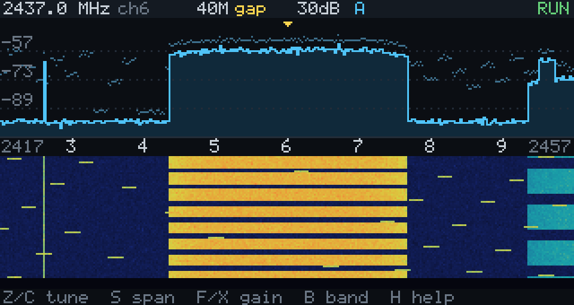

# wsdr-zero

wsdr-studio for the [M5Stack CardputerZero](https://docs.m5stack.com/en/CardputerZero) (Raspberry Pi
CM0, 64-bit ARM Linux, 320 × 170 screen, keyboard): the same receive engine as the desktop app, shown
as one spectrum and waterfall and driven from the keys. It installs as an app of the device's
launcher (APPLaunch).

**Status: not yet run on a CardputerZero.** It is cross-built for ARM, its unit tests pass on x86 and
on ARM under emulation (`qemu-aarch64`), and the screen below is from the simulated adapter. The
framebuffer, the keyboard and the dongle over the CM0's USB are untested on the device: see
[First run on the device](#first-run-on-the-device).



## What it does, and what it leaves out

The CM0 has USB 2 only, so every adapter runs in its USB 2 mode:

| Span | Mode | Sampled |
|---|---|---|
| 2.5, 5 MHz | continuous | all of the time |
| 10, 20, 40 MHz | gapped (one 8192-sample slice, shipped, repeat) | ~35 / 21 / 12 % |
| 80 MHz (8812BU only) | gapped | ~6 % |

- 2.4 GHz and 5 GHz (the 8812EU: 5 GHz only), fixed gain or AGC, antenna A, B or both, peak hold.
- IQ recording (SigMF, as the desktop app) on the continuous spans: 20 MB/s at 5 MHz.
- **No Wi-Fi frame analysis** (Mark signals, the frame inspector, network names): it needs 20 or
  40 MS/s continuous, which USB 2 does not carry. The engine only runs it on such streams, so nothing
  had to be switched off.
- No second view (Panorama, Compare) and no Spectral Map.

5 MHz continuous needs 40 MB/s, the most USB 2 carries on a desktop; the CM0 shares its one USB 2
controller between all ports and the Ethernet chip. If the header shows `FAULT` (the stream was
restarted), use 2.5 MHz or a gapped span. The app starts at 20 MHz gapped.

## Keys

| Key | |
|---|---|
| Z / C | tune 5 MHz down / up (with Shift: 20 MHz); held keys repeat |
| 0–9, then Enter | go to a channel (1–14, 16–233), or to a frequency in MHz (2400–2500, 5000–6170) |
| B | 2.4 GHz / 5 GHz |
| S | next span (with Shift: the previous one) |
| F / X | gain up / down |
| G | AGC on / off |
| A | antenna A, B, both |
| P | peak hold on / off |
| R | record IQ (continuous spans), again to stop |
| D | next adapter (while stopped) |
| Space or Enter | start / stop |
| H | the key list |
| Esc held for a second | exit to the launcher |

F, X, Z and C are the launcher's own up, down, left and right; the arrow keys (Fn + F/X/Z/C) do the
same. The app starts the first adapter it finds, and starts it again when it is plugged back in.

## Install

Build the package on a PC (below), copy it to the device and install it:

```sh
scp build-arm64/wsdr-zero_0.1.0-1_arm64.deb pi@<device>:
ssh pi@<device> sudo apt install ./wsdr-zero_0.1.0-1_arm64.deb
```

**WSDR Zero** then appears in the launcher (it rescans its apps every few seconds). The package holds:

| Path | |
|---|---|
| `/usr/share/APPLaunch/bin/wsdr-zero` | the app |
| `/usr/share/APPLaunch/applications/wsdr-zero.desktop` | its launcher entry |
| `/usr/share/APPLaunch/share/images/wsdr-zero.png` | its icon |
| `/usr/lib/udev/rules.d/70-wsdr.rules` | lets the logged-in user and the `plugdev` group open the dongles |

It depends on `libusb-1.0-0` and `libfftw3-single3` (apt fetches them) and needs glibc ≥ 2.38
(Debian 13 "trixie").

The kernel's own Wi-Fi driver (rtw88) claims the dongle when it is plugged in; Start takes it over.
To keep that driver away for good:

```sh
printf 'blacklist rtw88_8822bu\nblacklist rtw88_8822cu\n' | sudo tee /etc/modprobe.d/wsdr-studio.conf
```

**The CardputerZero Store** takes apps through a pull request to its package registry (`czdev
publish`, [AppBuilder](https://github.com/CardputerZero/AppBuilder)), with screenshots, an icon, and
for a first release a video of the app running on a device. That step is not done: it needs the app
verified on a device first, and the package's `Maintainer` set to the publisher.

## Build

On Debian or Ubuntu (x86-64), with the arm64 architecture enabled (`dpkg --add-architecture arm64`; on
Ubuntu the arm64 packages come from ports.ubuntu.com):

```sh
sudo apt install g++-aarch64-linux-gnu libusb-1.0-0-dev:arm64 libfftw3-dev:arm64 nlohmann-json3-dev \
                 binutils-mipsel-linux-gnu xxd cmake pkg-config dpkg-dev
git submodule update --init external/wifi-sdr
git -C external/wifi-sdr submodule update --init external/devourer
scripts/build-zero-deb.sh            # -> build-arm64/wsdr-zero_0.1.0-1_arm64.deb
```

The cross build (`cmake/aarch64-linux-gnu.cmake`) skips the desktop backend, which needs Boost.

**On a desktop** the normal build makes `build/wsdr-zero` too, with a preview window when SDL2 is
installed (`libsdl2-dev`):

```sh
cmake -S . -B build && cmake --build build -j --target wsdr-zero test_zero
build/wsdr-zero --sdl --demo         # a simulated adapter
build/wsdr-zero --sdl                # a real dongle (USB 2 mode, as on the device)
build/test_zero                      # unit tests: the UI's commands and picture, the framebuffer copy, keys
build/wsdr-zero --demo --script "wait:4,shot:/tmp/a.ppm,s,wait:3,shot:/tmp/b.ppm,quit"   # scripted keys, screenshots
```

## First run on the device

Nothing below has been checked on a CardputerZero yet. Over SSH, with the launcher's app closed:

1. `ls -l /dev/fb* /dev/input/event*; cat /proc/fb; cat /sys/class/graphics/fb0/bits_per_pixel` — the
   app draws to the ST7789 framebuffer named in `/proc/fb` (else `/dev/fb0`), at 16, 24 or 32 bits per
   pixel, and reads every keyboard under `/dev/input`. `--fb`, `--rotate 0|90|270` and `--input`
   override what it picks (as do `LV_LINUX_FBDEV_DEVICE` and `LV_LINUX_KEYBOARD_DEVICE`).
2. `/usr/share/APPLaunch/bin/wsdr-zero --demo` — the screen and the keys, without a dongle. It prints
   the display and keyboard it uses.
3. Plug a dongle in; `lsusb` shows `0bda:b812`, `0bda:c812` or `0bda:a81a`. Then
   `/usr/share/APPLaunch/bin/wsdr-zero 2> log.txt`: the engine's bring-up log goes to `log.txt`. A
   bring-up takes 10–20 s on USB 2.
4. Try 2.5 MHz, 5 MHz and the gapped spans; watch for `FAULT` in the header and how the CPU fares
   (`top`).

Things that may need a change once it runs: the framebuffer's pixel format or orientation, whether
the keypad reports Shift as a held key, whether the launcher lets go of the screen while an app
runs, and the dongle's power draw on the device's USB port.

## Layout

| Path | |
|---|---|
| `zero/ui.*` | the screen and the keys (commands out, events and rows in) |
| `zero/canvas.*` | the 320 × 170 picture and its 5 × 7 font |
| `zero/platform.*`, `platform_sdl.cpp` | framebuffer and evdev; the SDL preview window |
| `zero/backend_engine.cpp`, `backend_demo.cpp` | the real engine (`src/engine`), and the simulated adapter |
| `zero/packaging/` | launcher entry, icon, udev rule |
| `scripts/build-zero-deb.sh` | the cross build and the package |
| `tests/test_zero.cpp` | unit tests |
